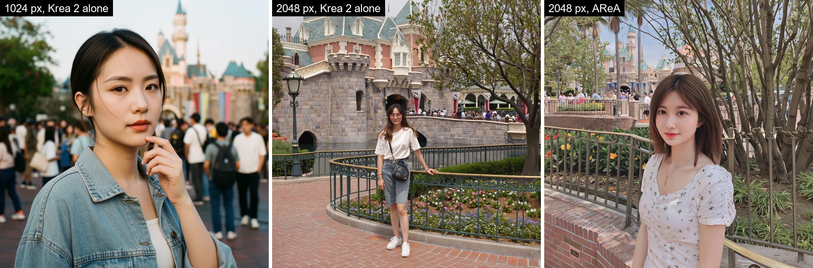
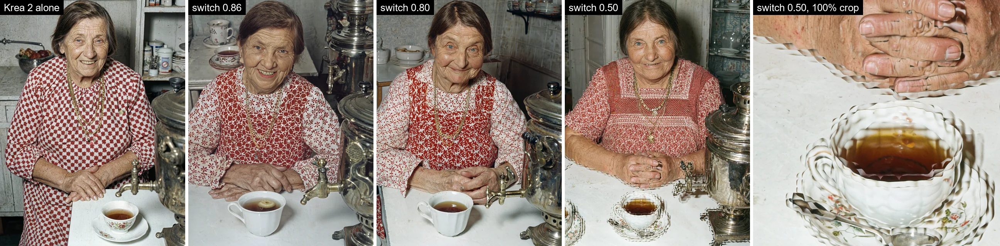
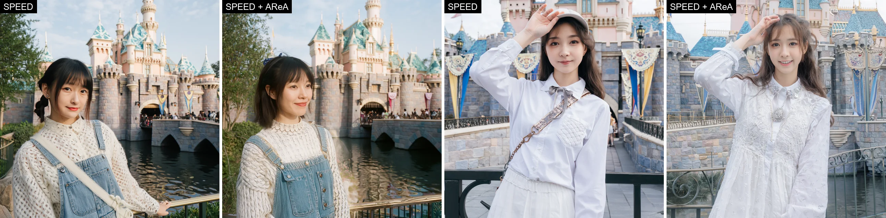
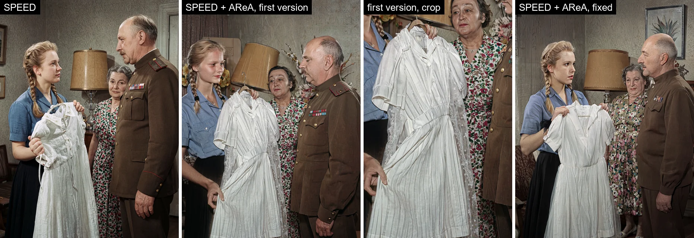
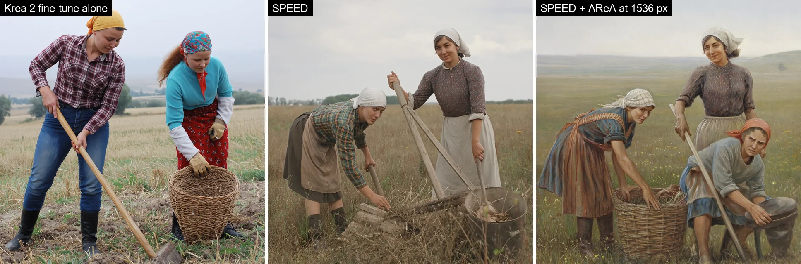

# Neo-Krea2-AReA

A Forge Neo extension that brings AReA to Krea 2. An experiment.

## The paper

[AReA: Adaptive Receptive-Field Attention for Efficient High-Resolution Diffusion Transformers](https://arxiv.org/abs/2610.17227) by Javad Rajabi, Koorosh Roohi, David B. Lindell and Babak Taati ([project page](https://rajabi2001.github.io/area/)).

The paper is about generating images far above the resolution a model was trained at, 2K to 6K on a 1K model, with no training and faster than the model would normally run at that size. The authors noticed that in the early denoising steps, while the composition forms, every part of the image looks across the whole picture, and in the late steps, while details are added, mostly at its own neighbourhood.

AReA follows that. In the early steps every part of the image looks at a reduced copy of the whole picture, about the size the model was trained at, so the composition forms at a scale the model knows. In the late steps each part looks only at a window around itself, and the windows shrink towards the training size step by step. A thin ring of neighbours around each window and a few distinctive patches from the rest of the picture keep the windows consistent with each other. The authors show it on FLUX.1, Qwen-Image, FLUX.2 and Ideogram 4 and report up to 3.2x speedup.

## Sample code

The authors published sample code for FLUX.1: [github.com/KooroshRH/AReA](https://github.com/KooroshRH/AReA) (Apache 2.0). The parts of it that do not depend on the model are used here unchanged.

## The extension

For Krea 2 in Forge Neo: RAW, Turbo and fine-tunes. Install from URL in Extensions:

```text
https://github.com/aoleg/Neo-Krea2-AReA
```

The options sit in the "AReA (Krea 2)" accordion:

- **Native extent**: the size the model was trained at, in 16 px patches. RAW (64) is 1024 px, Turbo (128) is 2048 px. AReA does nothing on canvases smaller than twice this, so 2048 px for RAW.
- **Phase switch sigma** (0.80): the noise level where the early steps (reduced copy) hand over to the late steps (windows). Lower means more early steps.
- **Pooling** (subsample): how the reduced copy is made. Subsample and random keep one patch per block, mean averages the block, medoid keeps the most typical one.
- **Halo** (8): how far each window looks past its edges, in patches.
- **Bridge ratio** (0.5): how many patches from the rest of the picture each window gets. 0 turns them off.
- **Minimum window** (0): the smallest window size. 0 is the native extent. For calibration only.
- **Seed** (-1): drives window placement, ring widths and random pooling. -1 follows the generation seed.
- **Apply to hires-fix pass**: run AReA during hires fix.
- **Log**: print the plan for each pass to the console.

The settings go into the image infotext and paste back.

## What we saw

Most tests ran on Krea 2 RAW (int8) with the Turbo LoRA at 0.5, ER SDE (Reverse-time), Beta 57, 12 and 20 steps, at 2048x2048 and 1728x2304, on an RTX 5090. One set ran on a Krea 2 fine-tune at 1536x1536.

Krea 2 handles high resolution pretty well by itself. At 2048x2048 and 1728x2304 it gave coherent pictures with no duplicated people and no repeated scenery, which is the main problem AReA is built to fix.

### Framing

At 2048 px Krea 2 composes the picture like a 1024 px one with more room around it: a wide shot with a small figure. AReA brings back the close framing Krea 2 gives at 1024 px.



### Phase switch

The paper switches at 0.86 on Qwen-Image. On Krea 2 at 20 steps that duplicated objects: one samovar became two. The windows started before the composition had settled, and at that point they could not afford the extra patches that tie them together, so each window finished the object on its own. At 12 steps the same setting was fine, since the step after the switch landed lower. 0.80 and 0.83 fixed it. 0.50 is unusable: every edge is echoed two or three times. The default is 0.80.



### Canvas size

Just above the native size AReA does more harm than good. Its reduced copy lands below the training size, and the windows cost nearly as much as full attention, so they get nothing to tie them together. In tests this gave a second, translucent dress and an extra person in a picture of two (both in the SPEED section below). AReA now stays off below twice the native extent.

### Speed

AReA was slower in every test.

| Canvas | Run | Seconds per step |
|---|---|---|
| 2048x2048 | Krea 2 alone | 1.64 |
| 2048x2048 | AReA | 1.76 |
| 1728x2304 | SPEED, full-size steps | 1.55 |
| 1728x2304 | SPEED + AReA, full-size steps | 1.94 |

At 2K attention is about a third of the work. The window steps are allowed to cost as much as full attention to keep the windows connected, and this implementation adds overhead on top. The paper's speedup grows with size and is largest at 4K and above; we did not test 4K.

### With SPEED

[SPEED](https://github.com/aoleg/ComfyUI-SPEED) runs the early steps at half size and the rest at full size. The two extensions work together without knowing about each other: SPEED makes the composition at half size, and AReA only runs on the full-size steps. At 2048 px that worked. SPEED's composition stayed, and AReA changed clothes and small details.



At 1728x2304 SPEED's half-size steps run at 864x1152, just above the native size, and the first version of the extension ran there too. It moved SPEED's composition around, and the dress came out twice, one over the other. AReA now leaves those steps alone.



At 1536 px, with the limit set to 1.5x at the time, AReA added a third person to a picture of two. That is where the limit went up to 2x.



Hires fix, 4K and Turbo are not tested yet.

## Conclusion

This is a sample implementation of an interesting idea. For Krea 2 in particular it did not play the way we expected: the model already handles 2K well, AReA mostly changed the framing, the phase switch and the size limit needed tuning, and at 2K it runs slower. Still an interesting experiment.

## Credits and license

This extension is derived from the AReA sample code, [github.com/KooroshRH/AReA](https://github.com/KooroshRH/AReA) (commit 9e38ec2), by Javad Rajabi, Koorosh Roohi, David B. Lindell and Babak Taati, released under the [Apache License 2.0](https://github.com/KooroshRH/AReA/blob/main/LICENSE). Its four model-independent modules (`schedule.py`, `tiling.py`, `bridge.py` and `attention.py`) are vendored in `lib_krea2_area/` with a header line naming the source; `NOTICE` lists them and what was changed in each. The Krea 2 adapter follows the structure of upstream's FLUX.1 backbone adapter. All credit for the method belongs to the authors; any defect in the Krea 2 port is this project's.

If you use this work, please cite the paper:

```bibtex
@misc{rajabi2026area,
      title={AReA: Adaptive Receptive-Field Attention for Efficient High-Resolution Diffusion Transformers},
      author={Javad Rajabi and Koorosh Roohi and David B. Lindell and Babak Taati},
      year={2026},
      eprint={2610.17227},
      archivePrefix={arXiv},
      primaryClass={cs.CV},
      url={https://arxiv.org/abs/2610.17227},
}
```

This extension is licensed under the Apache License 2.0, the same license as upstream; see `LICENSE` and `NOTICE`. Copyright 2026 Oleg Afonin.
